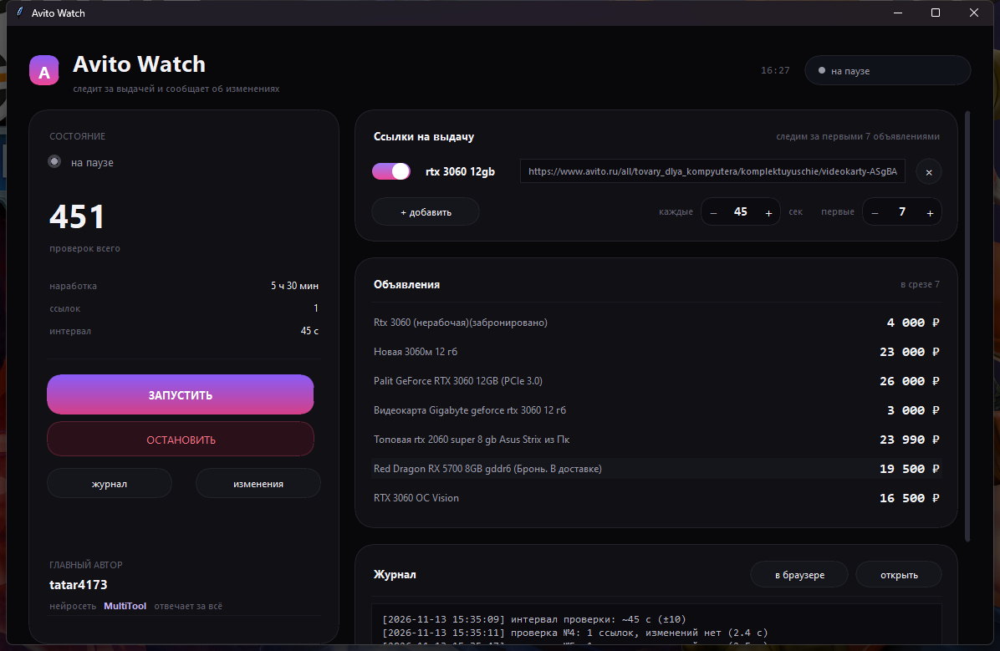

# Avito Watch

Монитор выдачи Avito: следит за первыми объявлениями в поиске и сообщает о новых или о смене цены.



## Возможности

- Несколько ссылок на поиск, у каждой свой переключатель
- Проверка каждые N секунд (по умолчанию 45, с разбросом ±10)
- Слежение за первыми N объявлениями (по умолчанию 7)
- Сравнение по внутренним id: новое объявление, смена цены, снятие с продажи
- Оповещение: звук, окно в правом нижнем углу, скриншот в `shots\`
- Отдельный Chrome с постоянным профилем, окно за краем экрана, без иконки в панели задач
- Автоподъём браузера, если окно закрыли
- Кнопки «показать Chrome» и «скрыть Chrome»: окно мониторинга можно открыть как обычное или убрать за край экрана
- Журналы: `общий-лог.txt`, `лог.html`, `изменения.txt`
- Окно с живым журналом и списком найденных объявлений

## Требования

- Windows 10/11
- Python 3.10 или новее (при установке — «Add Python to PATH»)
- Google Chrome
- Интернет

## Установка

### Готовый установщик

1. Открыть [Releases](../../releases) и скачать `AvitoWatch-setup-1.0.0.exe`
2. Запустить, оставить галочку «Установить зависимости»
3. По желанию — ярлык на рабочем столе и вход в Avito

Установщик проверяет Python и Chrome, сам ставит `playwright` и `psutil`, создаёт `config.json` из образца.

### Из исходников

```
pip install -r requirements.txt
запустить.bat
```

Или вручную:

```
pythonw app.pyw
```

## Использование

1. Вставить ссылку на поиск Авито
2. Указать интервал проверки и число первых объявлений
3. Нажать «ЗАПУСТИТЬ»

Первые два прохода идут молча — это базовый срез. Дальше сравнение с ним.

## Что создаётся рядом

| Файл | Назначение |
|---|---|
| `chrome-profile\` | отдельный профиль браузера, вход сохраняется |
| `state.json` | последний срез объявлений |
| `общий-лог.txt` | журнал за всё время работы |
| `лог.html` | живой журнал в браузере |
| `изменения.txt` | только изменения |
| `shots\` | скриншоты в момент изменения |

## Сборка установщика

Нужен [Inno Setup 6](https://jrsoftware.org/isinfo.php).

```
ISCC.exe installer.iss
```

Результат — `dist\AvitoWatch-setup-1.0.0.exe`.

## Ограничения

- Avito может показать капчу: решить вручную в окне Chrome, проверки продолжатся
- При лимите на первые N объявлений снятие с продажи не отслеживается
- При смене разметки Авито селекторы могут перестать работать
- Компьютер не должен уходить в сон
- Интервал меньше 30 секунд повышает риск капчи

## Дисклеймер

Программа работает с публичными страницами поиска и не обходит защиты. Правила Avito могут ограничивать автоматические запросы — используйте разумный интервал и не запускайте несколько копий одновременно.

## Версии

Текущая версия — в файле [VERSION](VERSION), история — в [CHANGELOG.md](CHANGELOG.md).

Схема: `MAJOR.MINOR.PATCH`. Тег в git совпадает с версией (`v1.0.0`), версия
дублируется в `installer.iss` и в обоих `.py`. Сборка на тег проверяет, что
все три совпадают, иначе падает.

Чтобы выпустить новую версию: поднять номер в трёх файлах, обновить
`CHANGELOG.md`, закоммитить и поставить тег.

## Лицензия

MIT — см. [LICENSE](LICENSE).

Автор: **tatar4173** · нейросеть **MultiTool**
